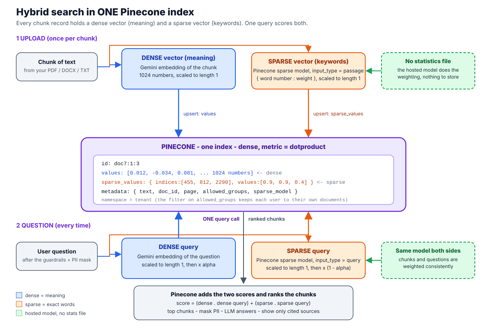

# Hybrid search (meaning + keywords) in one Pinecone index



Every chunk is stored once, with **two vectors in the same record**:

| Vector | Made by | Finds |
|---|---|---|
| **dense** (1024 numbers) | Gemini embedding | text with the same *meaning*, even in different words |
| **sparse** (word number : weight) | Pinecone's hosted model `pinecone-sparse-english-v0` | text containing the same *words*: names, codes, acronyms |

One query sends both. Pinecone adds the two scores and returns one ranked list. **There is no statistics file to store**:
the hosted model does the word weighting for chunks and for questions.

> **Want true BM25 from Elasticsearch instead of Pinecone's sparse model?** See
> [ELASTICSEARCH_SETUP.md](ELASTICSEARCH_SETUP.md). Pinecone then keeps only the meaning side, and the two result
> lists are merged by rank. When Elasticsearch is configured it takes over the keyword side automatically.

## How the app decides what to do
The index type decides, with no code change:

| Index metric | Mode |
|---|---|
| `dotproduct` | **Hybrid**: dense + sparse in every record |
| `cosine` | **Dense-only**: exactly the original behaviour |

Both vectors are scaled to length 1, so each side scores between 0 and 1 and `HYBRID_ALPHA` blends them fairly:
`score = alpha x dense_score + (1 - alpha) x sparse_score`.

If Pinecone's sparse model is unavailable, uploads store dense-only chunks and questions use meaning-only search.
Nothing fails.

## Files
| File | Role |
|---|---|
| `app/llm.py` | `embed()` (Gemini, normalised) and `sparse_embed()` (Pinecone sparse model, batched, retried once) |
| `app/vector.py` | creates the index, stores both vectors, runs the blended query, deletes |
| `app/graph.py` | asks for the sparse query vector; falls back to dense-only if that fails |
| `worker/ingest.py` | creates a sparse vector for every chunk at upload |
| `scripts/migrate_to_hybrid.py` | copies an existing dense index into a new hybrid one (no Gemini calls) |
| `scripts/compare_search.py` | measures dense-only vs hybrid on your documents to choose `HYBRID_ALPHA` |
| `test/test_hybrid.py` | 18 offline tests (also run by CI) |

## Settings (`.env` / GitHub)
| Name | Default | Meaning |
|---|---|---|
| `PINECONE_INDEX_NAME` | | Which index the app uses. A `dotproduct` index turns hybrid on |
| `PINECONE_METRIC` | `dotproduct` | Metric for an index the app has to create |
| `SPARSE_MODEL` | `pinecone-sparse-english-v0` | The hosted keyword model |
| `HYBRID_ALPHA` | `0.6` | 1.0 = only meaning, 0.0 = only keywords |
| `MIN_RELEVANCE` | `0.25` | Lowest combined score that counts as evidence |

## Moving an existing deployment to hybrid
1. **Copy the data** (reads the old index, writes a new one, changes nothing else):
   ```powershell
   python scripts/migrate_to_hybrid.py --target atlas-hybrid-index --dry-run   # count only
   python scripts/migrate_to_hybrid.py --target atlas-hybrid-index
   ```
2. **Compare quality** (optional, reads only):
   ```powershell
   python scripts/compare_search.py --index atlas-hybrid-index
   ```
3. **Switch**: set `PINECONE_INDEX_NAME` to `atlas-hybrid-index` (in `.env`, and in GitHub: Settings > Environments >
   production), then run the deploy again. Run step 1 once more just before switching if anyone uploaded documents
   since, because the copy is repeatable (records are overwritten by id).
4. **Roll back**: set `PINECONE_INDEX_NAME` back to the old name and redeploy. The old index is never modified.

New uploads after the switch get both vectors automatically.

## Tuning
* **`HYBRID_ALPHA`**: run `scripts/compare_search.py` with your own questions (`--questions file.json`, see its header).
  On the sample documents, `0.6` found the right chunk in first place 75% of the time (meaning-only: 66%) and in the
  top three 100% of the time (meaning-only: 91%). A small sample, so measure on yours.
* **`MIN_RELEVANCE`**: scores are lower in hybrid mode (about 0.3 to 0.5 for good matches). On the sample documents
  unrelated questions scored up to 0.28 and relevant ones from 0.30, so values between 0.25 and 0.29 are reasonable.
  Raise it as the collection grows.

## Limits to know
* The model is **English-only** (`english` is in its name).
* It is **billed per token** on every upload and every question, and rate-limited.
* A chunk is truncated if it exceeds the model's input length (the default chunk size is well inside it).
* It is a trained model, not exact BM25: it matches words and gives related words some weight.
